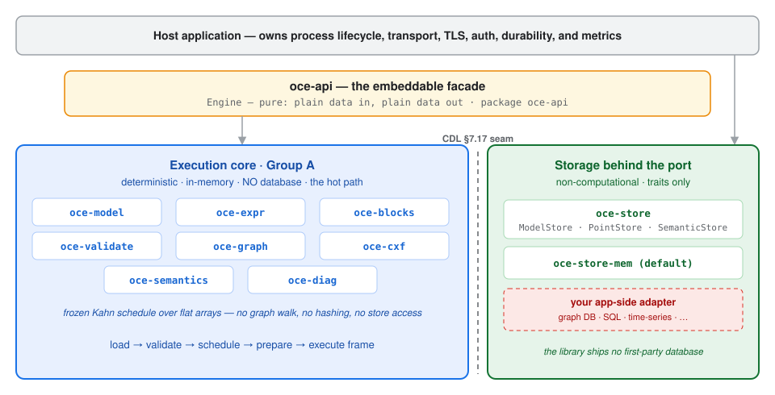

# Open Control Engine

**Open Control Engine runs building control sequences written in the OBC / LBL
[Control Description Language (CDL)](https://obc.lbl.gov/specification/cdl.html), as a Rust
library you embed in your own application.**

[](#license)
[](docs/architecture.md#embeddability-posture)
[](docs/architecture.md)
[](https://jscott3201.github.io/open-control-engine/)

You hand it a control sequence as a CXF document (CDL's JSON-LD exchange format). It parses,
validates, and compiles that sequence into a frozen topological schedule, then ticks the schedule
deterministically — the same document, parameters and input sequence produce bit-identical outputs,
run to run and across x86_64 and arm64, checked against committed goldens on both architectures on
every pull request.

It is a library and nothing else: no `main`, no daemon, no network listener, no async runtime, and
no database. Everything non-computational — points, trends, tags, durability — sits behind a
storage port your application implements. That split is not a design preference; it is CDL §7.17,
which states that such metadata does not affect the computation of a control signal.

Its four execution-core crates build `#![no_std]` on `core` and `alloc` alone, and the work in
progress lets a verified sequence leave a `std` host as a compiled-schedule blob that a bare-metal
or WASM target executes without the CXF importer. See [Status and roadmap](#status-and-roadmap).

Today it loads and simulates **46 ASHRAE Guideline 36 sequence fixtures** against a registry of
**133 CDL block classes**\*. It is **pre-1.0 and not published to crates.io**.

\* One of the 133, `TrueHoldWithReset`, uses a local two-input interface that is not in the CDL
catalog, so a conforming single-input document is refused. See the note in
[CDL coverage](docs/cdl-coverage.md).

Read the [product contract](docs/product-contract.md) for the versioned executable-CXF/HostTick
boundary, current limitations, host obligations and future acceptance outcomes.

---

## Who this is for

- **BAS and OEM product teams** who need a sequence runtime inside a controller or supervisory
  product, without adopting a database or a runtime framework along with it.
- **Commissioning and FDD tool authors** who need the same sequence to produce the same numbers
  today that it produced last quarter, as evidence rather than as a hope.
- **CDL researchers and toolchain authors** who want an independent executable implementation to
  compare against.

If you are looking for a finished building-automation product, this is not that. It is the engine
such a product would be built on.

---

## Quickstart

The facade package is **`oce-api`**. `open-control-engine` is a reserved umbrella name for a future
release, **not** a current alias — nothing is on crates.io yet, so depend on it via git. Pin a
revision appropriate to your release process rather than following a moving branch:

```toml
[dependencies]
oce-api = { git = "https://github.com/jscott3201/open-control-engine", rev = "<commit-sha>" }
```

Load a CDL sequence from CXF and execute complete typed frames:

Every point is named by an authored `@id` from the CXF document, expanded against the document's
`@context` to canonical absolute form at ingest — the declared boundary input's `@id` for a
boundary-driven point, the connector's own otherwise — so the same key names the same point
across loads of the same document, including a document re-serialized between compact and
expanded spellings. The document's declared boundary-output names (root `S231:hasOutput`) read
as aliases for their driving connectors on `get_output` and `watch`. These are latest-state,
non-receipt inspection surfaces. `CompletedFrame` retains the committed executable boundary
outputs in lexical identity order, independently of later engine changes.

```rust
use oce_api::{Engine, Value};

const ECONOMIZER: &str = "http://example.org#g36.ahu_economizer";

fn main() -> Result<(), Box<dyn std::error::Error>> {
    let mut engine = Engine::new(); // A pure engine: no storage backend, no database.
    let cxf_bytes = std::fs::read("crates/oce-cxf/tests/fixtures/g36/ahu_economizer.jsonld")?;
    engine.load_cxf(&cxf_bytes)?;

    // The host owns cadence and supplies every required observation on each frame.
    for index in 0..=4 {
        let time = f64::from(index);
        let observations = [
            (format!("{ECONOMIZER}.return_air_temp"), Value::Real(24.0)),
            (
                format!("{ECONOMIZER}.outdoor_air_temp"),
                Value::Real(18.0 + time),
            ),
            (format!("{ECONOMIZER}.operating_mode"), Value::Integer(1)),
        ];
        let entries: Vec<_> = observations
            .iter()
            .map(|(p, v)| (p.as_str(), v.clone()))
            .collect();
        let prepared = engine.prepare_frame(time, &entries)?;
        let completed = engine.execute_frame(prepared)?;
        println!(
            "frame {} at {}: {:?}",
            completed.sequence(),
            completed.time(),
            completed.outputs()
        );
    }
    Ok(())
}
```

To run the engine's own tests from a clone:

```bash
git clone https://github.com/jscott3201/open-control-engine
cd open-control-engine
cargo nextest run -p oce-api -p oce-blocks -p oce-expr # the state-determinism subset
bash .agents/gate.sh                            # the gate script CI runs; see its closing report
                                                # for the per-PR checks it cannot cover locally
```

---

## What it does today

- Imports CXF via the CDL §7.1 resolver, and **exports** back to CXF under a round-trip contract
  where re-importing the emitted bytes renders bit-identically — Reals compared by IEEE-754 bits,
  not by epsilon. See [CXF round trip](docs/cxf-round-trip.md).
- Executes a registry of **133 CDL elementary block classes** plus 3 reserved internal lowering
  classes, enumerable at runtime via `oce_api::catalog()` with per-class ports, parameter rules,
  and honest parameter defaults. See [CDL coverage](docs/cdl-coverage.md).
- Runs **46 G36 conformance fixtures** end to end through the frozen facade, each with a committed
  whole-sequence golden trace.
- Executes exclusively through `prepare_frame` followed by consuming `execute_frame`, or by slot:
  `frame_slots` resolves the boundary once and `execute_slots(&slots, t, &values)` then submits each
  complete frame through the same core driver, with the same refusals, borrowing its outputs and
  allocating nothing per frame once the map exists, beyond warning-record growth. The engine is
  pure: it has no storage dependency, and `load_cxf` returns the resolved model and IO inventory as
  a plain-data `LoadedModel`. Hosts own cadence, persistence and equipment delivery; for
  persistence, `oce_store::host::persist_loaded_model` runs the post-load recover → save →
  validate-inputs sequence against any adapter behind the storage port (or the in-memory
  `oce_store::MemStore`).
- Builds its execution core — `oce-model`, `oce-expr`, `oce-blocks` and `oce-graph` —
  `no_std + alloc` behind a default `std` feature, checked for `thumbv7em-none-eabihf`,
  `riscv32imac-unknown-none-elf` and `wasm32-unknown-unknown` on every pull request that changes
  the engine, and linked into a bare-metal firmware image for both bare-metal targets that is held
  to a size budget per PR and run under QEMU nightly, where its per-frame results must equal the
  host's. Every `f64` operation `core` lacks goes through
  `libm`, bit-identical to the `std` methods, and clippy refuses `std` float methods and hash
  collections inside those four crates. See
  [the core four](docs/architecture.md#no_std--alloc-the-core-four).
- Proves determinism on every engine-changing pull request rather than asserting it: goldens on
  x86_64 and arm64
  natively, a populated portable state snapshot compared byte for byte across the two, a
  per-frame allocation census, and a hash-order-independence test that loads every fixture under
  twenty independently seeded hashers and requires identical outputs, receipts and snapshot bytes.
- Compiles a loaded executable to an `OCEB` compiled-schedule blob — `Engine::compile_blob` in
  `oce-api` encodes it, `oce_graph::blob::decode` in `oce-graph` (built `no_std`) decodes it into a
  ready-to-tick schedule and run state, checking each class against a per-class signature hash. The
  46 blob goldens are byte-identical across x86_64 and arm64, the decoded executable matches the
  facade bit for bit after every tick, and hostile bytes are refused with typed errors. A decoded
  blob executes through the same HostTick frame driver as the facade (`oce_graph::blob::Executable`,
  inputs and outputs by slot, zero allocations per frame), and every pull request that changes the
  engine runs the blob round trip: blobs encoded on x86_64 are decoded and run natively on arm64 and
  under wasmtime on `wasm32-wasip1`, with every output, warning and raw state word after every
  frame of the 46 fixtures bit-identical to the recorded host run. See
  [compiled-schedule blob](docs/compiled-schedule-blob.md#the-blob-round-trip).

## What it does not do

Stating this plainly is more useful than a feature list.

- **It does not parse or flatten Modelica `.mo` sources.** It executes the block graph a CXF
  document hands it; the `oce-cxf` resolver lowers that document and nothing elaborates it further.
- **It is not general ASHRAE G36 support.** The supported set is explicitly
  *selected-explicit-cxf-variants-supported*: pre-flattened CXF at specific parameterizations, not
  other G36 composites. [What "supported" means](docs/cdl-coverage.md).
- **Its external-reference evidence is four cases, not broad engine coverage.**
  `CDL.Logical.Nand` has one exhaustive Boolean case, `CDL.Logical.Toggle` has one stateful Boolean
  event schedule, and `CDL.Reals.Line` has one finite matrix covering four limit modes and five
  input regions. One composed G36 Reliefs leaf has a seven-state exact-bit case at its declared
  outputs. No complete G36 sequence or general numeric tolerance has been checked that way, and the
  global Tier-3 report remains skipped —
  [read the full accounting](docs/verification-evidence.md).
- **`CDL.Logical.Pre` is a host-tick delay, not Modelica event iteration.** Under the fixed
  [HostTick v1 profile](docs/execution-profile.md), every successful `Engine::execute_frame` call advances
  `Pre` once, including repeated calls at the same timestamp. Exact Modelica/OpenModelica `Pre`
  equivalence is outside the conformance claim.
- **It has no Python bindings**, no daemon, no scheduler, and no database.
- **`halt()` does not stop execution.** It only opens the tune-at-rest window in which
  `set_param` is accepted; complete-frame execution can continue while halted with no pending edits.
- **Deferred loader signatures have been removed.** `load_from_semantic` and `load_modelica`
  are no longer callable; prepare supported CXF externally and use `load_cxf`.
  See [facade migration](docs/facade-migration.md) for the pre-release source break.
- **Assertion events and `AssertLevel` are Warning-only.** `AssertLevel::default()` is now
  `Warning`; the never-emitted `AssertLevel::Error` variant was removed. This adds no escalation
  or safety policy. See [facade migration](docs/facade-migration.md).

---

## Status and roadmap

The current release is **v0.4.0** (milestone M1b, November 2026): the execution core builds
`no_std + alloc` with its math through `libm` and no hash collections, a loaded executable compiles
to an `OCEB` blob on the host and runs on a `no_std` target through the same HostTick frame driver
as the facade, a firmware image is built and size-checked per PR for two bare-metal targets and
executed under QEMU nightly, and every engine PR replays one recorded run of the 46 fixtures' blobs
bit for bit on x86_64, arm64 and `wasm32-wasip1`. v0.3.0 (M1a) made the engine pure and moved the
per-PR gate to native x86_64 and arm64 cells under one required `CI OK` status. Next come M2 (the
authoring layer) and M3 (the verification product), in parallel; M3's first engine change, the
facade's slot-indexed execute entry, is in, and so is the first leverage crate built on it:
`oce-replay`, which drives the engine frame by frame from recorded or scripted inputs (columnar
arrays, a bounded CSV reader, step lists) under an explicit missing-sample policy and records a
columnar, bit-exact trace. See [CHANGELOG.md](CHANGELOG.md).

Work is planned as GitHub milestones and cut into issues. Each milestone has a tracking issue that
lists the order, the hard dependencies and the gate that closes it. The engine milestones, in order:

| Milestone | Goal | State |
| --- | --- | --- |
| **M1a** Portable core: cleanup | Pure `Engine`, dead crates and ledgers removed, two CI lanes, native determinism and strict-bit matrices | Released as v0.3.0 |
| **M1b** Portable core: `no_std` | Core four build `no_std + alloc`; math through `libm`; hash-free core; the **OCEB** compiled-schedule blob (encoder in `oce-api`, decoder in `oce-graph`, byte-stable across architectures); a `no_std` execution entry that never links `oce-cxf` or `oce-api`; a bare-metal gate cell with a size budget over `thumbv7em`, `riscv32imac` and `wasm32`; QEMU execution nightly | Released as v0.4.0 |
| **M2** Authoring layer | `oce-author`: one typed authoring model with strict-JSON and text forms, a validator that runs before the engine sees anything, and a deterministic emitter to CXF | Next, in parallel with M3 |
| **M3** Verification product | Canonical content id, vector format v2, an `oce-verify` replayer with receipts and a mutant score, a funnel-style tolerance mode, on the `oce-replay` historical replay crate | In progress: `oce-replay` is in; in parallel with M2 |
| **M4** WASM | `oce-wasm` over `oce-api`, a TypeScript package, a browser demo that replays vectors without a server, a tracked `.wasm` size budget | Planned, in parallel with M5 |
| **M5** Python | `oce-py` wheels (PyO3, abi3) over the same surface; replay and receipts from a notebook | Planned, in parallel with M4 |
| **M6** Reference host | `oce-host`: cadence, staleness limits, the non-finite policy, degraded mode and safe-state outputs as tested code; BOPTEST client and a Docker runtime | Planned, in parallel with M7 |
| **M7** Composite lowering | Composites first-class on import, with canonical lowering order and a content id equal to the flattened form, so the library ships reusable routines | Planned, in parallel with M6 |
| **M8** Semantics | `SemanticPoint` records (Brick, 223P, QUDT, Haystack) carried through import and export without the tick ever reading them; `oce-bind` matches a building graph to a sequence | Planned |
| **M9** BACnet device image | One `no_std` image that is a BACnet device: compiled sequence inside, boundary points as objects, MS/TP or B/IP outside, over rusty-bacnet | Planned |

The three one-page design passes M3 waits on are written: the
[historical replay API](docs/design/replay.md) (built as `crates/leverage/oce-replay`), the
[CDL §12 commissioning verifier](docs/design/commissioning.md) and
[`oce-diff`](docs/design/diff.md), beside the [M2 authoring layer](docs/design/authoring-layer.md).
Design notes for thinly specified work land in
[`docs/design/`](docs/design/compiled-schedule-blob.md) before code; the OCEB blob format is the
first. Sequences, routines and their test vectors live in the separate `open-control-library`;
this repository keeps only the minimal conformance corpus.

---

## Before you drive equipment

The engine deliberately implements **no fail-safe policy of its own**, and that is a decision your
host layer has to answer for:

- **Every boundary input is required exactly once.** Missing values refuse before mutation;
  there is no sparse staging, implicit zero, or hold-last execution profile.
- **Typed values are not sensor-quality evidence.** Frame preparation checks types and declared
  domains, not host freshness, plausibility or permission to command. Stored samples are not consulted.

Staleness limits, fault reactions, and safe-state fallback belong in the host above the engine.
**[Host responsibilities](docs/host-responsibilities.md)** is the checklist; read it before wiring
anything to a physical output.

---

## Architecture

CDL §7.17 states that point lists, trends, display units, tags, and Brick / Haystack / ASHRAE 223P
semantics do not affect the computation of a control signal. That one rule is the seam the whole
system is built around: an execution core that sees only blocks, typed connections, and values, and
a storage port for everything else, which the host reaches and the engine never does.



Full layer-by-layer detail, the crate map, and the platform and MSRV policy are in
**[Architecture](docs/architecture.md)**.

---

## How it is verified

Six evidence layers in this repository are called "tests", and they prove different things.
One of them proves nothing about correctness at all — the 46 fixture goldens are **engine
self-output**, a determinism snapshot that catches drift, not wrongness.

Correctness is bounded separately by 422 provenance records generated by a tool held off the
workspace and **forbidden from depending on the block library**, with CI enforcing that
code-dependency firewall. Of the 420 signal goldens, 398 check CDL / Buildings source semantics and
22 check the HostTick v1 profile instead: 20 G36 signals across three `Pre`-dependent fixtures and
the two standalone `CDL.Logical.Pre` goldens.
399 retain their existing exact comparisons, including all 135 G36 sequence goldens. The other
21 transcendental, psychrometric, and solar Real goldens compare exactly on qualified Linux
x86_64/aarch64 debug/release and retain the unchanged 1e-12 aligned band on unqualified targets.
That Linux result is re-established per-PR: the scoped strict-bit subset and its four suite
binaries run in four native Linux cells (x86_64 and aarch64, debug and release) with repeat
captures and a cross-cell comparison, and no source file is bound to a stored receipt any more
([strict-bit evidence](docs/strict-bit-evidence.md)). It bounds the claim to the pinned
corpus, rustc and libm; it is not mathematical correctness or arbitrary-input proof. The blob round
trip in `oce-conformance` also runs per-PR, from one recorded x86_64 artifact replayed natively on
arm64 and under wasmtime on `wasm32-wasip1`
([blob round trip](docs/compiled-schedule-blob.md#the-blob-round-trip)). The remainder
of `oce-conformance` still needs the release/full gate.

Two global report tiers are **not wired**, and no complete G36 sequence here has been executed against an
external Modelica / Buildings toolchain. The separate OpenModelica evidence covers exhaustive
Boolean Nand, one stateful Boolean Toggle schedule, one finite exact-bit Line matrix, and one
seven-state exact-bit case for a composed G36 Reliefs leaf.

**[Verification and evidence](docs/verification-evidence.md)** sets out what each layer proves, what
it cannot, and which checks are not running.

---

## Documentation

The `docs/` pages below are also published as a site:
**[jscott3201.github.io/open-control-engine](https://jscott3201.github.io/open-control-engine/)**.
`TESTING.md` and `SECURITY.md` are not on it; they are repository-only. The site is built from
`main`, so it trails `development` by a release — where the two differ, the Markdown in this
repository is the newer copy.

| Page | For |
| --- | --- |
| [Architecture](docs/architecture.md) | Layers, the §7.17 seam, the crate map, platform and MSRV |
| [Execution profile](docs/execution-profile.md) | HostTick semantics and the `CDL.Logical.Pre` conformance boundary |
| [Verification and evidence](docs/verification-evidence.md) | What has been proven, and what has not |
| [CDL coverage](docs/cdl-coverage.md) | Which classes and sequences run, and what "supported" means |
| [CXF round trip](docs/cxf-round-trip.md) | Export guarantees, and where it silently drops things |
| [CXF composite subset](docs/cxf-composite-subset.md) | Normative contract for external CXF emitters |
| [Host responsibilities](docs/host-responsibilities.md) | What you must implement before driving equipment |
| [Product contract](docs/product-contract.md) | The versioned executable-CXF / HostTick boundary and its evidence map |
| [State compatibility](docs/state-compatibility.md) | Snapshot and checkpoint bytes: what is portable, what is target-bound |
| [Strict-bit evidence](docs/strict-bit-evidence.md) | What the per-PR native matrix proves about exact Real results |
| [Facade migration](docs/facade-migration.md) | Pre-1.0 source breaks and how to move across them |
| [Compiled-schedule blob](docs/compiled-schedule-blob.md) | What travels in an OCEB blob, what does not, versioning and the trust model |
| [Design notes](docs/design/compiled-schedule-blob.md) | One-page decisions written before thinly specified work; currently the OCEB blob format |
| [CI and the gate](docs/ci-and-the-gate.md) | What runs when, and what a green check proves |
| [Benchmarks](docs/benchmarks.md) | Measured tick throughput, per run |
| [Testing standard](TESTING.md) | The bar every change is held to |
| [Security](SECURITY.md) | Reporting, threat model, and known limits |

---

## Contributing

Changes land via pull requests into `development`. Install the shared git hooks once after cloning
with `bash scripts/install-hooks.sh`, and run `bash .agents/gate.sh` before opening a PR — that
script is the single source of truth for what CI runs.

Read **[CONTRIBUTING.md](CONTRIBUTING.md)** first, and **[TESTING.md](TESTING.md)** before writing a
test. Notable changes are in **[CHANGELOG.md](CHANGELOG.md)**. Coding agents start from
**[AGENTS.md](AGENTS.md)**, the issue-driven milestone workflow this repository runs on.

One thing worth knowing up front: the per-PR gate runs the `oce-api`, `oce-blocks`, and `oce-expr`
state-determinism subset plus the scoped `oce-conformance` strict-bit subset. Changes outside
those and the named input-hygiene audits can show every check green without running their own
tests. The gate also has two lanes under the one `CI OK`: a documentation-only change compiles
nothing (`README.md` is the exception, because a test reads its Quickstart), a change under
`crates/leverage/` runs the lighter leverage lane, and anything else runs the full determinism
lane. [CI and the gate](docs/ci-and-the-gate.md) explains the split.

---

## License

Dual-licensed under either of:

- Apache License, Version 2.0 ([LICENSE-APACHE](LICENSE-APACHE))
- MIT license ([LICENSE-MIT](LICENSE-MIT))

at your option. Unless you explicitly state otherwise, any contribution intentionally submitted for
inclusion in the work by you shall be dual-licensed as above, without any additional terms or
conditions.

`third_party/` vendors upstream Modelica Buildings CDL sources and modelica-json CXF translations
verbatim, under their own license — see
[`third_party/modelica-buildings-cdl/README.md`](third_party/modelica-buildings-cdl/README.md). That
tree sits outside every crate root, so `cargo package` never ships it.
